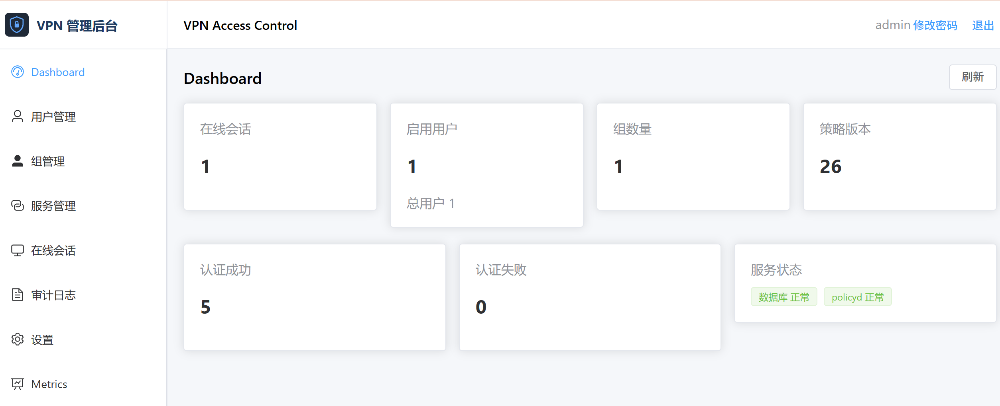
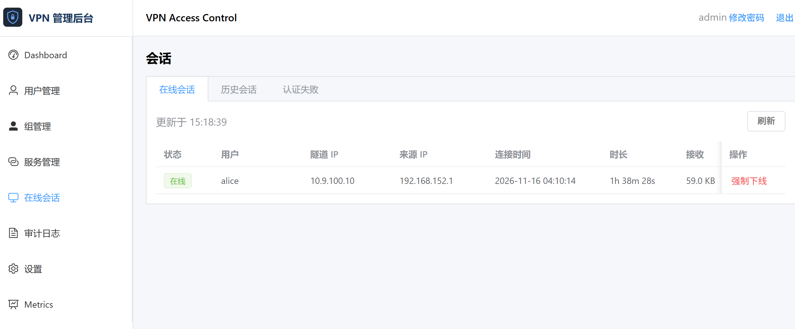
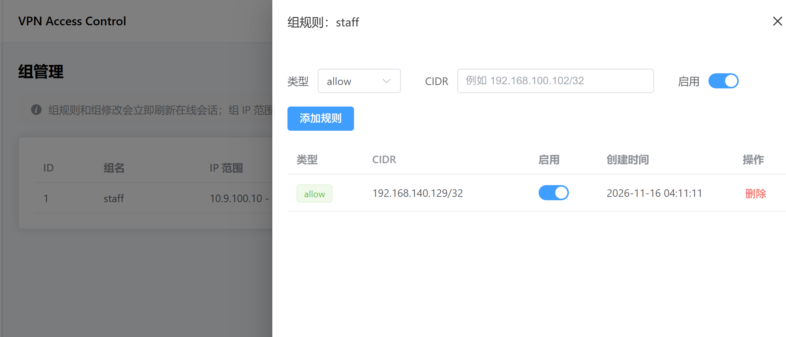

# VPN Access Control

> 远程接入的最小权限网关：**谁能连进来、能访问哪些资源、访问了多少、什么时候收回**，
> 全部在 Web 后台完成，并在网关侧强制生效。

基于 OpenVPN + nftables，纯自托管，不依赖云控制面。

当前版本：**0.3.3**



## 界面预览

<p>
  
  
</p>

左侧是实时会话（隧道 IP、来源 IP、时长、流量、强制下线），右侧是组级 allow/deny
规则；用户级规则与"有效策略"预览在同一个抽屉里完成。

---

## 为什么不是"又一个 VPN 面板"

`push "route ..."` **不是访问控制**——它只是告诉客户端"这些网段走隧道"，
客户端自己 `route add` 就能绕过。真正的强制只能在服务端转发路径上做。

所以本项目的核心不是"把 OpenVPN 包一层界面"，而是：

- 每个用户/组有独立的 **allow / deny 规则**，`push_routes = allow − deny`；
- 同一份策略生成 **nftables 转发规则**，在网关侧真正 drop；
- 每个用户可以额外授权访问 **网关自身的服务**（如只允许 DNS），此前在 VPN 面板里很少见；
- 策略变更写 `vpn_policy_version`，在线会话原子刷新；
- 会话、用量、认证失败、审计全部落本库，可查询、可导出、可按天留存。

## 架构

```
                    ┌──────────────────────────────────────────┐
   OpenVPN 客户端 ──▶│ vpn-openvpn    (host netns, tun0, 1194)  │
                    │   auth-user-pass-verify → vpn-auth-check │
                    └───────────────┬──────────────────────────┘
                                    │ unix socket (IPC)
                    ┌───────────────▼──────────────────────────┐
                    │ vpn-policyd   (host netns, NET_ADMIN)    │
                    │   算策略 → nft -f 原子下发 / 计费 / 对账   │
                    └───────────────┬──────────────────────────┘
                                    │
   ┌────────────┐   ┌───────────────▼──────┐   ┌──────────────────┐
   │ vpn-web    │──▶│ vpn-admin (HTTP API) │──▶│ vpn-mariadb      │
   │ nginx+TLS  │   │ 会话/审计/指标        │   │ vpn_* 表          │
   └────────────┘   └──────────────────────┘   └──────────────────┘
```

所有组件都在 `compose.yaml` 里，六个容器：`mariadb / policyd / openvpn / admin / web / retention`。
`retention` 每天执行一次历史数据清理。
`openvpn` 和 `policyd` 使用**宿主网络命名空间**（因为要建 `tun0`、操作宿主 nftables）。

## 快速开始

前置：Rocky Linux 10 / RHEL 10（EL10）或同代 glibc 的发行版，root 权限。
其余依赖（podman、编译工具链、Node.js 等）可以用 `--with-deps` 自动安装。

```bash
# 一键安装（裸机首次安装加 --with-deps）
sudo ./deploy/install.sh --with-deps
```

脚本会自动完成：

- 安装缺失的系统依赖（仅 RHEL 系，`--with-deps`）；
- 检查环境（podman / tun / nft / 端口）；
- 编译 C++ 组件（`build/` 不存在时）与构建前端（`dist/` 不存在时）；
- 生成 `.env`（随机数据库密码）与 `/etc/vpn-policy/*.conf`；
- 生成 Web 自签证书、OpenVPN CA / 服务端证书 / `ta.key`；
- 应用 `sql/` 下的 schema；
- 构建镜像、启动全部服务、等待 `/readyz` 通过；
- 创建管理员 `admin`，并在最后**只打印一次**初始密码。

常用参数：

```bash
./deploy/install.sh --check       # 只检查环境和依赖，不改动任何东西
./deploy/install.sh --with-deps   # 先安装系统依赖再继续
./deploy/install.sh --proxy URL   # 所有下载走 HTTP 代理
./deploy/install.sh --offline     # 不联网/不编译，使用已有二进制与 deploy/images/*.tar
./deploy/install.sh --demo        # 额外创建 staff 组与 demo 用户
./deploy/install.sh --uninstall   # 停止并移除容器（保留数据）
```

### 内网 / 离线安装

目标机器访问不了 Docker Hub 时，先在联网机器导出镜像：

```bash
./deploy/save-images.sh          # 输出 deploy/images/*.tar（mariadb / nginx / app）
```

把代码和 `deploy/images/` 一起拷过去，然后：

```bash
./deploy/install.sh --offline
```

注意 `--offline` 需要 `build/`（C++ 二进制）和 `vpn-admin/web/dist/` 已经就绪。

### 代理

```bash
./deploy/install.sh --proxy http://192.168.1.1:10809
```

代理会同时传给 dnf、npm 和 podman 的镜像拉取；`no_proxy` 默认包含
`localhost`、`127.0.0.1` 和内网网段。

### 部署前检查清单

- **服务器时间必须准确**（启用 NTP）。时钟偏移会让客户端报
  `certificate is not yet valid`，而且证书签发后无法“补救”，只能重签。
- **firewalld**：`install.sh` 不会改防火墙，需要手工放行 `http` / `https` /
  `1194/udp`；路由型 VPN 还需要给 tunnel 网段做 masquerade（或加回程路由）。
  firewalld 默认会 `reject` 未显式放行的 **转发** 流量，所以还要把 `tun0` 放进
  trusted 区（`firewall-cmd --zone=trusted --add-interface=tun0`，需要持久化时加
  `--permanent`），否则 nftables 策略放行了、包仍会被 firewalld 丢掉。
- **SELinux**：`Enforcing` 环境下 host netns + nft 通常可以工作；若遇到权限拒绝，
  给 `policyd` / `openvpn` 加 `--security-opt label=disable`。

## 首次使用

1. 浏览器打开 `https://<服务器IP>/`，用 `admin` 和安装时打印的密码登录；
2. 「组」里创建组，设置 IP 段（如 `10.9.100.10 - 10.9.100.200`）与 allow 规则；
3. 「用户」里创建用户，指定固定 IP；也可以在「服务」里授权网关自身的端口；
4. 把 `/etc/vpn-policy/client.ovpn` 发给用户（内置 CA 与 tls-auth，只需再输入账号密码）；
5. 用户连上后，后台「会话」能看到在线会话、实时流量与历史记录。

修改任意策略后，在线会话会被刷新；**收回权限立即生效**，新增权限可能需要重新连接一次
（OpenVPN 只在连接建立时推送路由）。

## 修改隧道网段

隧道网段同时存在于 **OpenVPN 配置**、**数据库设置**、**组/用户固定 IP** 和
**宿主防火墙**中，只改一处会出现"能连上但分配不到 IP"或"策略校验失败"。

> 后台「设置」页改不了：它会把新网段和现有组/用户做校验，先改设置一定报
> `group ... is outside the new tunnel network`。正确做法是一次性 SQL 事务。

以下以 `10.9.100.0/24 → 10.20.0.0/24` 为例，操作期间所有客户端会断开一次。

**0）备份数据库**

```bash
cd /root/vpn-acl
set -a; . ./.env; set +a
podman exec vpn-mariadb mariadb-dump -uroot -p"$MARIADB_ROOT_PASSWORD" \
    radius > /root/vpn-backup-$(date +%F).sql
```

**1）停栈**

```bash
podman-compose down
```

**2）改 OpenVPN 的 `server` 指令**

```ini
# deploy/openvpn/server.conf
server 10.20.0.0 255.255.255.0
```

这里用的是 **netmask 而不是 CIDR**：`/24 → 255.255.255.0`、`/16 → 255.255.0.0`、
`/22 → 255.255.252.0`。网关是第一个可用地址（`10.20.0.1`）。

**3）执行 SQL 事务**

模板见 [`deploy/examples/change-tunnel-network.sql`](deploy/examples/change-tunnel-network.sql)，
逐行改成你的新网段后执行：

```bash
podman-compose up -d mariadb
podman exec -i vpn-mariadb mariadb -uroot -p"$MARIADB_ROOT_PASSWORD" radius \
    < deploy/examples/change-tunnel-network.sql
```

它会更新：`tunnel_network`、`allowed_service_ips`、组地址池、用户固定 IP、
指向旧网关的 `vpn_server_services`，并递增 `vpn_policy_version`。

注意：

- 多个组/用户时逐条写，**不要**批量 `REPLACE` 固定 IP（会撞唯一键）；
- `vpn_group_rules` / `vpn_user_rules` 是"目标网段"，通常不用动；
- `nas_ip` 是宿主机地址，与隧道网段无关。

**4）同步防火墙**

```bash
firewall-cmd --permanent --remove-rich-rule='rule family="ipv4" source address="10.9.100.0/24" masquerade'
firewall-cmd --permanent --add-rich-rule='rule family="ipv4" source address="10.20.0.0/24" masquerade'
firewall-cmd --reload
```

静态回程路由同理替换。

**5）启动并验证**

```bash
podman-compose up -d
./build/vpn-policyctl --config /etc/vpn-policy/config show alice   # fixed_ip / push_route
nft list table inet vpn_acl | head
curl -s http://127.0.0.1:8080/readyz
```

客户端 `.ovpn` **不需要修改**（隧道网段由服务端 push），重连后会拿到新网段的地址。

**6）回滚**

```bash
podman-compose down
podman exec -i vpn-mariadb mariadb -uroot -p"$MARIADB_ROOT_PASSWORD" radius \
    < /root/vpn-backup-YYYY-MM-DD.sql
# 再把 server.conf 的 server 行改回去
podman-compose up -d
```

## 数据、配置与日志

| 内容 | 位置 |
|---|---|
| 数据库数据 | `./mariadb/data`（bind mount） |
| 服务配置 | `/etc/vpn-policy/{admin,policyd}.conf`、`/etc/vpn-policy/config/vpn-policy.conf` |
| OpenVPN 证书 | `/etc/openvpn/server/`（可通过 `VPN_OPENVPN_CERTS` 覆盖） |
| Web 证书 | `/etc/nginx/ssl/` |
| 日志 | `podman logs vpn-policyd` / `vpn-openvpn` / `vpn-admin` |

### 时区与日志时间

所有容器都通过 `.env` 的 `TZ` 继承时区（默认 `Asia/Shanghai`）。因此：

- `podman logs -t` 外层时间、`vpn-policyd` 文件日志、OpenVPN 日志与 status
  中的可读时间、nginx access log、数据库 `NOW()` 都是同一时区；
- OpenVPN status 的 `Connected Since (time_t)` 仍是 epoch，不受时区影响；
- 0.3.1 及更早版本的 `policyd` 日志文件内容是 UTC，升级时已被重命名为
  `vpn-policyd.log.utc`，新文件从本地时间开始。

如果部署在别的时区，修改 `.env` 的 `TZ` 后执行 `podman-compose up -d`
重建容器即可。

### 监控

指标在 `/metrics`（只允许本机抓取）。Prometheus 告警规则示例见
[`deploy/prometheus-vpn-alerts.yml`](deploy/prometheus-vpn-alerts.yml)。

### 数据留存

`retention` 容器每天自动执行一次清理，默认保留：会话历史与认证日志 180 天、
审计日志 365 天。手动触发：

```bash
podman exec vpn-retention /usr/local/sbin/vpn-policyctl \
  --config /etc/vpn-policy/config retention-cleanup --apply
```

### 访问审计

每个在线会话会记录「目标 IP、允许/拒绝、上下行字节、首次/最后访问时间」，
用于回答"谁在什么时候访问了什么、哪些被拒绝"，只记元数据，不采集内容。

实现方式：nftables 用三个带 `counter` 的动态集合（`flows` / `flows_rev` /
`flows_deny`）按「客户端隧道 IP . 目标 IP」计数；`vpn-policyd` 每
`flow_sample_interval`（默认 30 秒）采样一次，做差后累加到 `vpn_access_log`，
原始计数器保存在 `vpn_flow_state`，policyd 重启后继续做差，不会把停机期间的
增量当成基线丢掉。

`tun0` 的每个包都会重新匹配当前 per-user 策略（allow 规则逐包计数、deny 规则
逐包记录），所以 TCP/UDP 长连接的上行 ACK 也会被统计；**撤回 allow 后，客户端
发往该目标的包会立即被 drop**（反向在途数据仍可能短暂到达客户端，反向规则只
统计、不按 allow 列表过滤）。允许/反向集合 24 小时无流量才过期（连接/断开时
会主动清理），deny 集合保持 10 分钟，避免扫描流量长期占容量。

- Web：「访问审计」页面按用户、目标 IP、目标网段（反查"谁访问过这台机器"）、
  allow/deny、时间范围查询，支持 CSV 导出；
- 在线会话 / 历史会话列表有「访问记录」，用户列表也有快捷入口；
- 默认保留 180 天，可用 `retention-cleanup --access-days N` 调整。

精度边界（重要）：

- 只统计**经过隧道且进入策略链**的流量；split-tunnel 或客户端本地直连看不到；
- 字节是 L3 转发字节（含 IP 头），与 OpenVPN 会话总量口径不同（后者还包含
  keepalive 和加密/封装开销），属于**审计级近似**，不要用于计费；
- 目标与 allow/deny 是逐流记录的；暂不记录端口；
- 下行统计所有发往客户端的 established 流量（包括服务器主动发起的连接），
  因此可能出现 `up=0` 的 allow 记录；
- 单个目标 24 小时无流量才会从 allow/rev 集合过期，之后从 0 重新累计（已写入
  的历史记录不受影响）；deny 集合 10 分钟过期，扫描型流量可能占满集合容量，
  高安全场景请监控集合使用率；
- 升级后需要执行一次 `deploy/migrate.sh`；policyd 启动时会检查 schema，缺失
  会直接退出并提示，而不是带着不完整的审计运行。

### 开机自启

`install.sh` 会启用 `podman-restart.service`，容器在宿主重启后自动拉起。
如果系统没有这个 unit，重启后需要手工执行 `podman-compose up -d`。

## 边界（请先读这一段）

- **只管经过网关的流量**。客户端开了 split tunnel、或员工在办公室走内网交换时，
  本系统管不到那些路径。这是"远程接入准入"，不是全网微隔离。
- **`deny` 的真实语义**：不推送路由 + 网关侧 drop。若客户端能从其他路径直达该网段，
  网关无法阻止。
- **单实例**。目前没有 HA；数据库、policyd 都是单点。生产部署请配好备份与 RTO 预期。
- **仅 IPv4**、**固定 IP 必须落在组网段与 `tunnel_network` 内**。
- `tunnel_network` 同时存在于 DB 与 `deploy/openvpn/server.conf` 的 `server` 指令中，
  修改时两处必须一致。
- **SELinux**：若系统为 `Enforcing`，`host netns + nft` 的容器可能被拒绝，
  需要给 `policyd`/`openvpn` 加 `--security-opt label=disable`（当前验证环境为 Permissive）。

## 可选：把用量输出到 RADIUS

默认不依赖 FreeRADIUS。如果要把 Start/Interim/Stop 送到 `radacct`：

```bash
# policyd.conf: accounting_enabled=1，并配置 radius_server/port/secret
podman-compose --profile radius up -d
```

> **注意**：`freeradius/` 镜像基于第三方仓库
> `packages.inkbridgenetworks.com` 构建（EL10 官方仓库没有 FreeRADIUS 3.2），
> **不随本项目维护**。更稳妥的做法是不用这个 profile，直接把 `radius_server`
> 指向你已有的 RADIUS 服务器。详见 [`freeradius/README.md`](freeradius/README.md)。

## 开发与测试

```bash
cmake -S . -B build -DVPN_WITH_DB=ON -DVPN_WITH_ADMIN=ON
cmake --build build -j
ctest --test-dir build --output-on-failure
```

测试是自包含的：不需要数据库、网络、nftables 或 fixtures。

可靠性回归（需要已运行的栈）：

```bash
sudo ./deploy/test-reliability.sh
```

覆盖：重连隔离、并发连接、策略版本轮询、reconcile 自愈、过期 status
不产生重复的历史恢复记录。

访问审计回归（需要已运行的栈 + openvpn 客户端）：

```bash
sudo ./deploy/test-access-audit.sh
```

覆盖：允许目标的上行/下行字节（ICMP + TCP 长连接）、拒绝目标的记录、
传输中撤回权限立即生效、policyd 重启后继续累加、断开时最终采样与 nft 集合清理。

长时间稳定性（故障注入 + 采样）：

```bash
sudo ./deploy/soak-faults.sh --duration 10h --interval 15m
sudo ./deploy/soak-monitor.sh --duration 10h
```

`soak-faults.sh` 会轮流重启 openvpn/mariadb/policyd/admin、刷新网络、
改策略版本、模拟重连；`soak-monitor.sh` 每 5 分钟写一行 CSV。

## 许可证

本项目采用 **AGPL-3.0-only**：

- 完整文本见 [LICENSE](LICENSE)；
- 第三方组件与运行时依赖的许可证见 [NOTICE](NOTICE)；
- 贡献方式见 [CONTRIBUTING.md](CONTRIBUTING.md)。

企业内部自建自用不受 AGPL 的分发义务限制；对外提供修改版服务或分发时需要遵守 AGPL，
或联系维护者获取商业授权。